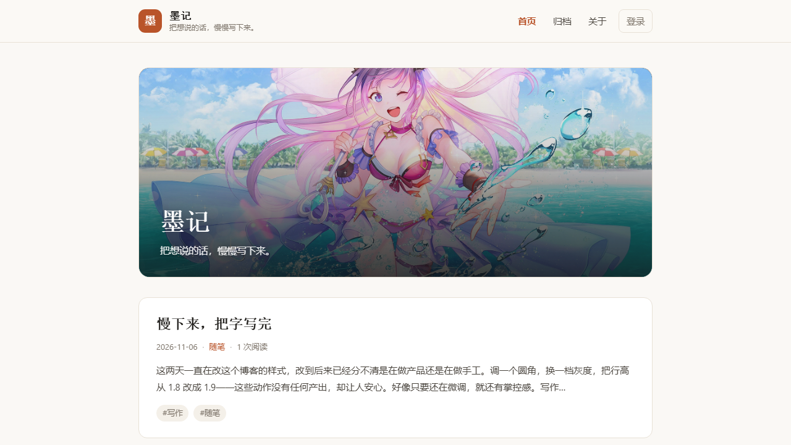
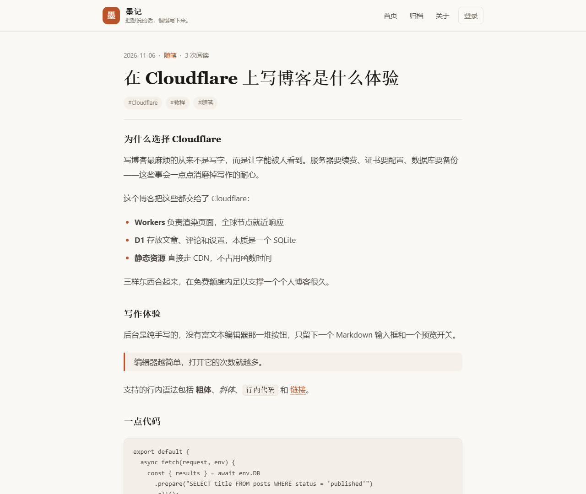
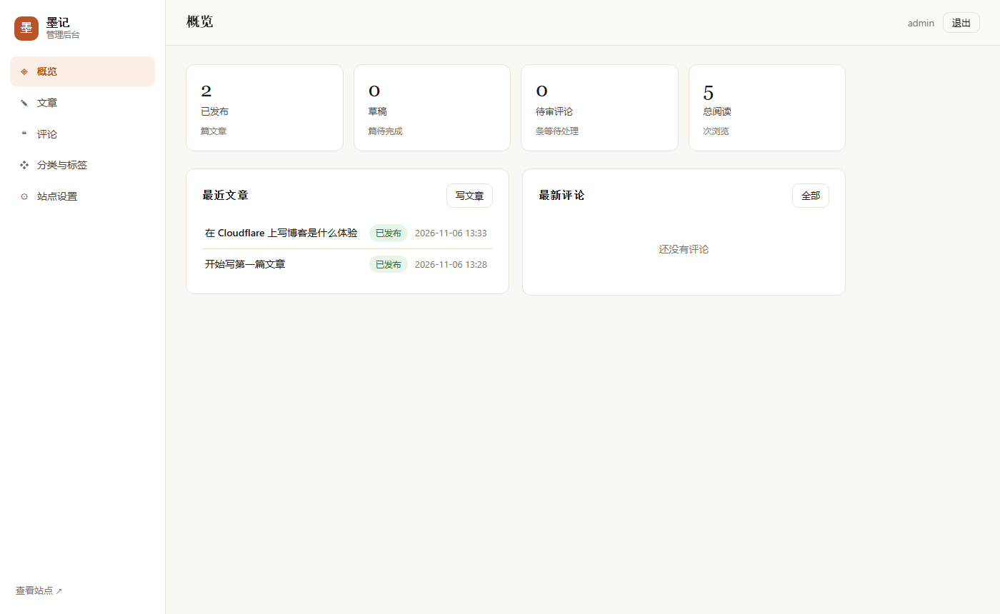

# 墨记 · Cloudflare 全栈博客

一个零依赖、可同时部署到 **Cloudflare Workers** 与 **Cloudflare Pages** 的完整博客系统。
前台展示 + 后台管理一体，数据存放在 **Cloudflare D1**（SQLite），无需服务器、无需对象存储、无需第三方 SaaS。

- 前台：首页随机背景图、文章列表、文章详情、分类、标签、搜索、分页、归档、关于页、评论（含 IP 归属地）、RSS、Sitemap
- 后台：登录鉴权、文章增删改、草稿 / 发布状态、评论审核、分类标签管理、站点设置、修改密码
- 部署：一条命令或一次 Git 推送即可上线，首次访问 `/setup` 自动建表并创建管理员

## 预览

| 前台首页 | 文章详情 |
| --- | --- |
|  |  |



> 界面跟随系统自动切换深色 / 浅色主题，截图摄于浅色模式。

---

## 一、技术栈

| 层 | 选型 | 说明 |
| --- | --- | --- |
| 运行时 | Cloudflare Workers（V8 Isolate） | 全球边缘节点，冷启动接近 0 |
| 兼容层 | Workers Static Assets / Pages Functions | 同一份源码两处部署 |
| 语言 | 原生 JavaScript（ES Module） | 无构建步骤、无打包器、无框架 |
| 数据库 | Cloudflare D1（SQLite） | 免费额度 5 GB 存储 / 500 万行读/天 |
| 模板 | 手写模板字符串 + `esc()` 转义 | 服务端渲染，SEO 友好，首屏无 JS 依赖 |
| 样式 | 原生 CSS + CSS 变量 | 支持深色模式与响应式，无 CDN 依赖 |
| 鉴权 | Web Crypto：PBKDF2-SHA256 + HMAC-SHA256 签名 Cookie | 不依赖 JWT 库，HttpOnly + SameSite |
| Markdown | 自研轻量渲染器（约 150 行） | 支持标题、列表、引用、表格、代码块、链接、图片 |

> 整个项目 **没有任何运行时 npm 依赖**，`package.json` 里只有开发用的 `wrangler`。
> 这意味着部署体积小、没有供应链风险、也不会因为某个包更新而挂掉。

---

## 二、目录结构

```
博客/
├── src/
│   ├── index.js              # 入口：路由表匹配 + 全局错误处理
│   ├── schema.js             # 建表语句（供 /setup 一键初始化）
│   ├── lib/
│   │   ├── auth.js           # 密码哈希、会话签名、登录校验
│   │   ├── db.js             # 所有 D1 查询（文章/分类/标签/评论/设置）
│   │   ├── markdown.js       # Markdown → HTML
│   │   └── utils.js          # 转义、日期、分页、Cookie、响应封装
│   ├── views/
│   │   ├── layout.js         # 前台布局与卡片/分页组件
│   │   └── admin.js          # 后台布局与表格组件
│   └── routes/
│       ├── public.js         # 前台路由
│       └── admin.js          # 后台路由（含 /setup 初始化）
├── functions/
│   └── [[path]].js           # Pages Functions 入口（转发到 src/index.js）
├── public/                   # 静态资源（由平台直接返回）
│   ├── style.css
│   ├── admin.css
│   ├── favicon.svg
│   └── robots.txt
├── schema.sql                # 建表脚本（命令行初始化用，与 schema.js 一致）
├── wrangler.toml             # Workers 部署配置（含 D1 绑定）
├── .dev.vars.example         # 本地环境变量示例
└── package.json
```

---

## 三、数据模型

| 表 | 作用 | 关键字段 |
| --- | --- | --- |
| `users` | 作者账号 | `username`、`password_hash`、`salt` |
| `posts` | 文章 | `title`、`slug`(唯一)、`content`、`status`(draft/published)、`published_at`、`views` |
| `categories` | 分类 | `name`、`slug` |
| `tags` | 标签 | `name`、`slug` |
| `post_tags` | 文章-标签多对多 | `post_id` + `tag_id` 联合主键 |
| `comments` | 评论 | `post_id`、`author`、`content`、`status`(pending/approved/spam)、`location`(IP 归属地) |
| `settings` | 站点配置键值对 | `site_name`、`site_desc`、`page_size`、`about`、`session_secret` … |

时间统一用 `INTEGER` 毫秒时间戳，展示时按东八区格式化。

---

## 四、路由与页面结构

### 前台

| 方法 | 路径 | 说明 |
| --- | --- | --- |
| GET | `/` | 首页文章列表（分页） |
| GET | `/page/:page` | 首页第 N 页 |
| GET | `/post/:slug` | 文章详情（正文 + 标签 + 评论） |
| POST | `/post/:slug/comment` | 提交评论（蜜罐 + 30 秒频控） |
| GET | `/category/:slug` | 分类列表页 |
| GET | `/category/:slug/page/:page` | 分类分页 |
| GET | `/tag/:slug` | 标签列表页 |
| GET | `/tag/:slug/page/:page` | 标签分页 |
| GET | `/search?q=` | 全文搜索（标题/摘要/正文 LIKE） |
| GET | `/archive` | 按年份归档 |
| GET | `/about` | 关于页（后台可编辑，支持 Markdown） |
| GET | `/rss.xml` | RSS 2.0 订阅 |
| GET | `/sitemap.xml` | 站点地图 |

### 后台

| 方法 | 路径 | 说明 |
| --- | --- | --- |
| GET/POST | `/setup` | 首次初始化（建表 + 创建管理员 + 示例文章） |
| GET/POST | `/admin/login` | 登录 |
| POST | `/admin/logout` | 退出 |
| GET | `/admin` | 概览（文章数、草稿数、待审评论、总阅读） |
| GET | `/admin/posts?status=all\|published\|draft` | 文章列表 |
| GET | `/admin/posts/new` | 新建文章 |
| GET | `/admin/posts/:id/edit` | 编辑文章（Markdown 编辑 + 实时预览） |
| POST | `/admin/posts/save` | 保存（新建/更新，自动生成唯一 slug） |
| POST | `/admin/posts/:id/delete` | 删除文章（连带标签与评论） |
| GET | `/admin/comments?status=` | 评论审核 |
| POST | `/admin/comments/:id/action` | 通过 / 待审 / 垃圾 / 删除 |
| GET | `/admin/taxonomy` | 分类与标签管理 |
| POST | `/admin/categories/new` | 新增分类 |
| POST | `/admin/categories/:id/delete` | 删除分类（文章转为未分类） |
| POST | `/admin/tags/:id/delete` | 删除标签 |
| GET/POST | `/admin/settings` | 站点设置 |
| POST | `/admin/password` | 修改密码 |
| POST | `/admin/api/preview` | Markdown 预览（需登录） |

---

## 五、环境变量与绑定

| 名称 | 类型 | 必填 | 说明 |
| --- | --- | --- | --- |
| `DB` | D1 数据库绑定 | 是 | 变量名必须是 `DB` |
| `SITE_NAME` | 变量 | 否 | 站点名称，用于初始化时的默认值 |
| `SETUP_TOKEN` | 变量 | 否（线上建议） | 保护 `/setup`，防止他人抢先创建管理员 |
| `SESSION_SECRET` | 变量 | 否 | 会话签名密钥；不填则首次初始化时随机生成并存入 D1 |

本地开发时把变量写进 `.dev.vars`（已被 `.gitignore` 忽略）。

---

## 六、快速开始

### 本地运行

```bash
npm install

# 可选：手动建表（不执行也行，访问 /setup 会自动建表）
npx wrangler d1 execute blog-db --local --file=./schema.sql

npm run dev
# 打开 http://localhost:8787/setup 创建管理员
```

### 部署到 Cloudflare Workers

```bash
npx wrangler login
npx wrangler d1 create blog-db          # 复制输出的 database_id

# 把真实配置放在本地文件里（wrangler.local.toml 已被 .gitignore 忽略）
cp wrangler.toml wrangler.local.toml
# 编辑 wrangler.local.toml，填上 database_id
npm run deploy:local
```

> 仓库里的 `wrangler.toml` 故意保留 `REPLACE_WITH_YOUR_DATABASE_ID` 占位符，可以放心提交到公开仓库。
> 真实 ID 写在 `wrangler.local.toml`，不会进版本控制。想省事也可以直接把 ID 填进 `wrangler.toml` 再 `npm run deploy`，
> 代价是这个 D1 的 ID 会公开（它本身不能直接访问数据库，但从隐私角度仍建议用前者）。

部署完成后访问 `https://<项目名>.<子域>.workers.dev/setup` 完成初始化。

### 部署到 Cloudflare Pages

```bash
npx wrangler pages deploy public --project-name my-blog
```

然后在 Pages 项目的 **Settings → Functions → D1 database bindings** 添加 `DB` 绑定，
或者用 Dashboard 的 Git 集成：构建输出目录填 `public`，构建命令留空，`functions/` 目录会被自动识别。

详细的分步教程（含 Dashboard 全网页操作、零命令行方案与排错）见 **[DEPLOY.md](./DEPLOY.md)**。

---

## 七、安全设计

- 密码：PBKDF2-SHA256 + 16 字节随机盐，迭代 2 万次（免费版 Worker 的 CPU 限额内）
- 会话：`uid.exp.signature` 三段式 Cookie，HMAC-SHA256 签名，HttpOnly + SameSite=Lax + Secure，7 天过期
- 所有写操作校验 `Origin` 头，配合 SameSite 缓解 CSRF
- 所有动态输出经 `esc()` 转义；Markdown 链接只允许 `http/https/mailto/相对路径`
- 评论：默认提交即公开（后台可一键切换为「需审核」），配合蜜罐字段与 30 秒内最多 3 条的频控
- 隐私：评论**不保存 IP**，只记录 Cloudflare 边缘解析出的国家 / 省级地区（如「中国 · 上海」），用于展示来源地
- 后台全部路由 `noindex`，`robots.txt` 屏蔽 `/admin`、`/setup`

---

## 八、常见问题

**Q：访问首页一直跳到 `/setup`？**
说明 D1 还没有绑定或表还没建。确认 `[[d1_databases]]` 的 `binding` 是 `DB`，然后打开 `/setup`。

**Q：部署报错 `Couldn't find a D1 DB with the name or binding 'DB'`？**
`wrangler.toml` 里的 `database_id` 还是占位符，需要换成 `wrangler d1 create` 输出的真实 ID。

**Q：中文标题生成的 slug 是中文，会影响 SEO 吗？**
不会。浏览器会自动百分号编码，搜索引擎也能正确识别。想要纯英文地址，在编辑页手动填 `url-slug` 即可。

**Q：忘记密码了怎么办？**
在 D1 控制台执行 `DELETE FROM users;`，然后重新访问 `/setup`。

**Q：图片怎么上传？**
本项目不包含对象存储。封面和正文图片填外链（图床、R2 公共域名、GitHub Raw 均可）。需要图床时可以后续接入 Cloudflare R2。

**Q：首页背景图不显示 / 想换图源？**
背景图默认取自 `https://www.loliapi.com/acg/`（二维图随机接口），每次刷新自动换一张。可以在后台「站点设置 → 首页背景图 API」改成任意返回图片的地址，清空则关闭背景图、只留纯色渐变。图片加载失败时会自动降级为深色渐变，不影响阅读。
